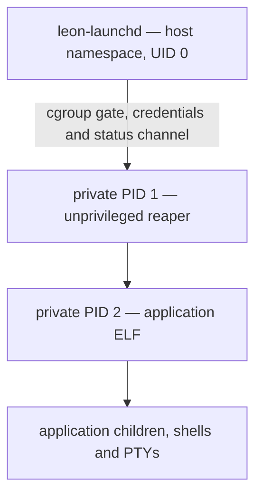

# Application isolation

The LeonMobile 1.0.0 reference image requires a private mount, PID and IPC
namespace for every application launched by `leon-launchd`, including built-ins
and Terminal. This extends the existing per-app Unix UID, Landlock ABI 3,
seccomp and cgroup v2 policy. There is no manifest opt-out or fallback on setup
failure. Native `--root` development fixtures deliberately bypass target
isolation; distribution units do not use that option.

## Filesystem and devices

The broker builds a new tmpfs root in a mount namespace with recursively private
propagation, then changes the namespace's root and working directory into it.
The system directories `/usr`, `/bin`, `/sbin`, `/lib`, `/lib64` (when present)
and `/etc` are bound read-only with `nosuid,nodev`. An installed app sees only
its pinned package version, not other installed packages or the mutable
`current` link. Built-in executables remain in the common read-only system
directories. Paths and relative library RPATHs inside the selected package
retain their meanings.

Only the app's own home and XDG runtime directory are bound writable; these
binds are `nosuid,nodev` and retain mode 0700 and the app's UID/GID. The broker
opens private directory endpoints without following symlinks before changing
ownership or mounting. Other app homes/runtimes, shared documents, system
private data, removable media and the host's `/sys` tree are absent. File access
continues through documentd/portald rather than exposing storage mounts.

Each launch creates the following private `nosuid,nodev,noexec` tmpfs mounts:

| Path | Maximum size | Inode limit |
| --- | --- | --- |
| `/tmp` (`TMPDIR`) | 32 MiB | 8192 |
| `/var/tmp` | 16 MiB | 4096 |
| `/dev/shm` | 32 MiB | 4096 |

They are shared by that application's descendants, isolated from other apps and
discarded when its namespace terminates. They are scratch space, including
`/var/tmp`; persistent state belongs in HOME/XDG data. The limits do not reserve
RAM and remain subject to the app cgroup's 256 MiB memory limit. Existing
`$HOME/.tmp` contents are retained as ordinary private data but are no longer
used as the production TMPDIR.

`/dev` is a separate small tmpfs containing only null, zero, full, random,
urandom, tty, standard fd symlinks, the private shm mount and a **newinstance**
devpts mount. `/dev/ptmx` points into that instance. Terminal, forkpty, controlling
TTYs and job control use these private PTYs. Hardware, disk, kernel log, input,
display and sound device nodes are absent. Apps cannot create device nodes or
mount, join or create namespaces. An authorized service may still transfer an
explicit descriptor through its own authenticated protocol.

The public service directories are bound read-only, preserving socket
replacement across service restarts. Host runtime state outside these
directories is absent. `prepare` creates the root-owned public
`/run/leon-system/` directory. netd atomically publishes `resolv.conf` there;
timed atomically replaces the `localtime` symlink there. Compatibility links at
`/run/resolv.conf` and `/run/localtime` preserve the existing `/etc` links on both
the host and app views. Directory binds allow DNS/timezone updates to reach
already running applications. No public JSON service schema changes.

## Processes, identity and cleanup

The app is a normal process rather than namespace PID 1, preserving ordinary
signal and fatal-core behavior. The small C17 PID 1 closes inherited descriptors,
drops supplementary groups and all root credentials, enables `no_new_privs`,
disables dumpability and reaps orphaned descendants. `/proc` is newly mounted
read-only for that PID namespace: apps see their own process tree and cannot
enumerate or signal host/other-app processes by their host PIDs. SysV IPC objects
and PTYs are private. The 128-process cgroup limit includes PID 1 and the app.

Before exec the trusted child identifies itself through a private sequenced
socket. Kernel `SCM_CREDENTIALS` translates its PID into the receiving broker's
namespace. The broker verifies its UID/GID and reports the **actual host ELF
PID** in launch/lifecycle/exit responses, preserving compositor, Root, crash and
service executable identity checks. An application-supplied PID is never used
as launch identity. Control/status descriptors do not reach the application ELF.

PID 1 retains the exited app as a zombie until the broker has received its raw
wait status, so its host PID cannot be reused during retirement. Graceful stop
signals are forwarded inside the namespace. App exit kills remaining namespace
processes; broker cleanup kills the whole cgroup, including detached processes.
Forced stop and unexpected PID 1 death retire the task only after real process
exit. Broker channel closure or death tears down the namespace; broker restart
also clears stale cgroups. All private mounts disappear with their namespace;
the host retains only an empty root-owned `/run/leon-sandbox` staging directory.

Root authorization starts a separate rootd helper or PTY in the system
namespaces. The original application remains isolated and unprivileged.
`SCM_RIGHTS` allows su to relay the authorized host PTY while its ordinary shell
continues using private devpts. See [root-access.md](root-access.md).

## Boundaries and validation

This is a developer policy on the reference QEMU target, not an independent
security certification. The kernel, network namespace, Wayland server and
AF_UNIX transport remain shared. `/proc` still exposes some system-wide kernel
statistics. Services must authorize peers and descriptors; this is not complete
information-flow isolation. Package signatures, general hardware permission
APIs, kernel hardening audits and physical phone validation remain separate work.
An explicitly authorized unrestricted Root helper can modify system policy.

`scripts/build-target-probes.sh` builds two test packages and the system probe.
`scripts/test-qemu.py --core-only --system-probe build/system-probe --timeout 240`
injects them only into a disposable disk. Its real broker launches cover distinct
mount/PID/IPC namespaces, private scratch and devpts, minimal devices, FD
inheritance, orphan reaping, host PID reporting, exact signal/exit/core status,
detached cleanup, forced stop, PID 1 failure, invalid staging/home symlinks and
fresh relaunches. Full interactive terminal and Root suites cover PTY consumers
and service authorization. Build evidence stays under ignored `build/`.
